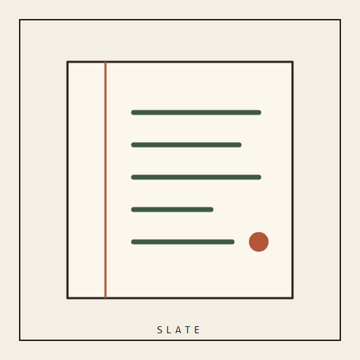
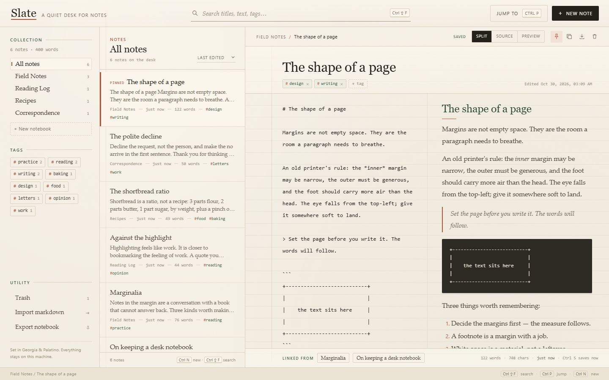
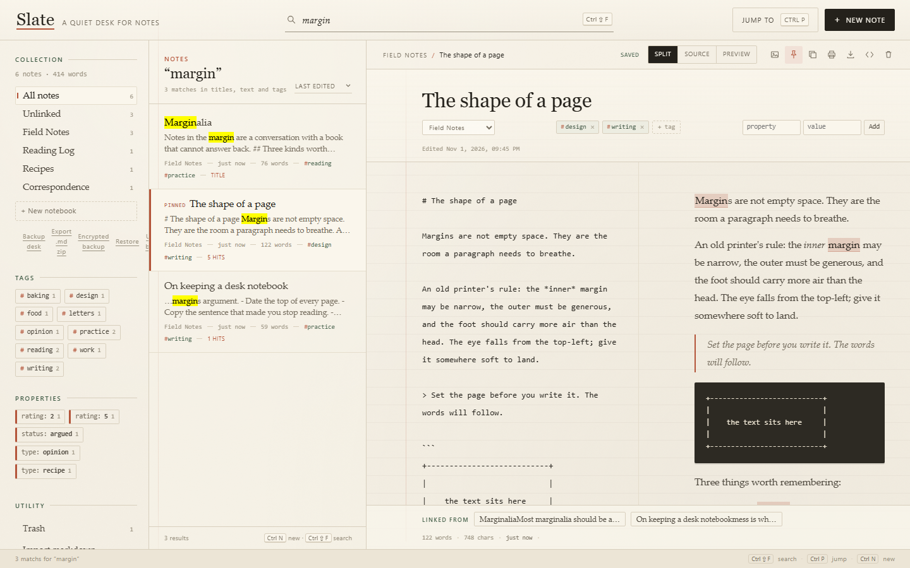
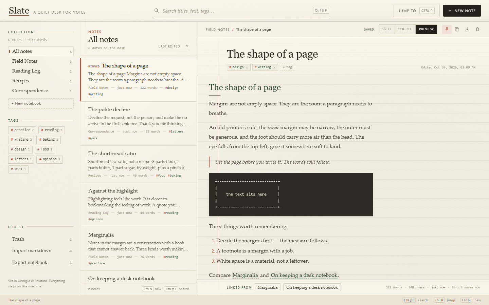
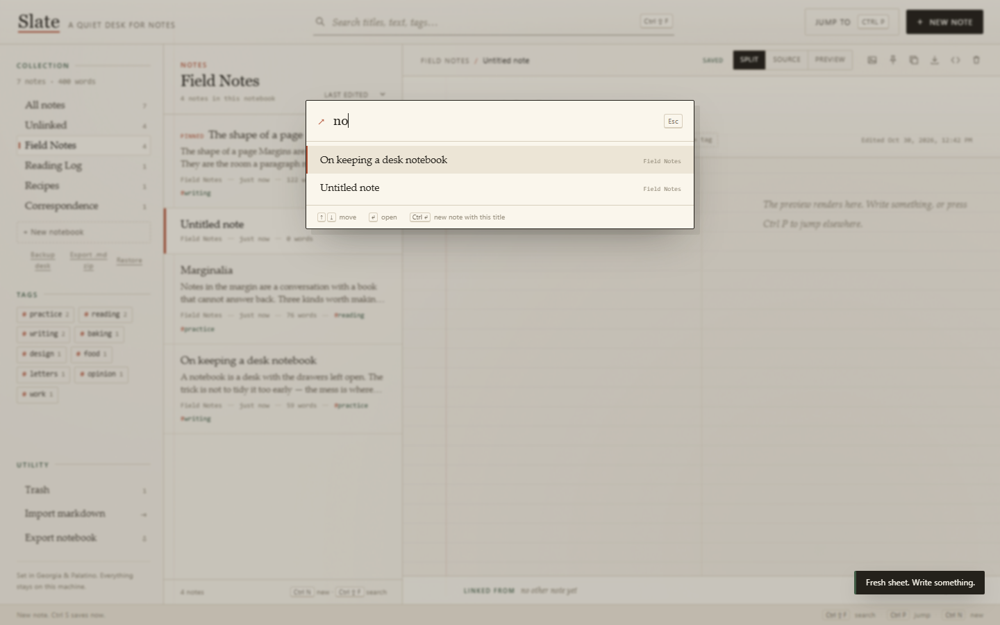

<div align="center">



# Slate

### A quiet desk for notes that belong to you.

A private markdown notebook with wiki links, backlinks, full-text search and images.

[](https://github.com/KHHH2312/slate/releases/latest)
[](https://github.com/KHHH2312/slate/releases)
[](#requirements)
[](LICENSE)



</div>

> **New — 1.2.0** — click a task checkbox in the preview; the markdown updates and saves.
> [Changelog →](CHANGELOG.md)

---

## Why Slate

**Writing tools should get out of the way.** Slate keeps three panes and no dashboards.

**Plain markdown and local files mean the notebook survives the app.**

**Links are first-class: wiki links and backlinks turn notes into a small, private graph.**

## Features

| | |
|---|---|
| **Notebooks & notes** | Folders, pinned notes, move and rename without losing the writing. |
| **Markdown desk** | Split, source or preview; autosave, word counts, clickable task lists and a quiet typographic page. |
| **Wiki links** | Type [[Title]] to link; a missing target is created on click. |
| **Backlinks** | Every note shows who links here, with a one-click jump. |
| **Search** | Full-text search with highlighted results and keyboard focus. |
| **Tags** | Tag any note, filter the desk by tag, see counts. |
| **Trash** | Trash, restore and permanent delete with a safeguard against skipping the trash. |
| **Images** | Insert, paste or drop PNG/JPEG/WebP pictures; stored locally with the note. |
| **Export/import** | Export a note as .md or a notebook as JSON; import markdown files. |

<div align="center">



</div>

## Requirements

- Windows 10 or 11, x64
- No account, no runtime install

## Install

1. Download **Slate-1.2.0-win32-x64.zip** from [Releases](https://github.com/KHHH2312/slate/releases/latest).
2. Verify it against `SHA256SUMS.txt`:
   ```powershell
   Get-FileHash .\Slate-*-win32-x64.zip -Algorithm SHA256
   ```
3. `FILEMANIFEST.txt` lists the SHA-256 and size of every file in the archive — diff it against what you unpacked.
4. Unzip anywhere and run **Slate.exe**.

> Self-signed development certificate: SmartScreen will warn until an OV/EV certificate is used.
> The SHA-256 checksum is the trust anchor.

## Using it

1. Install and launch Slate.
2. Create a notebook and a note, then write markdown in the editor.
3. Link another note with [[Title]]; follow it and check the backlinks panel.
4. Use Ctrl+Shift+F to search, Ctrl+P to jump, Ctrl+S to save now.

## Verified

- Model/API suite: 98 checks green.
- Browser golden proof: 31 checks green, including task toggling, a real image upload and render.
- Packaged app passes the source-parity integrity gate and ships with SHA-256 sums and a per-file manifest.

## Security and privacy

- Local-first: the app runs on loopback, stores data on your machine and sends no telemetry.
- Strict renderer policy, sandboxed window, denied navigation/window-open by default.
- Releases are integrity-gated, signed and published with SHA-256 sums and a per-file manifest.
- Found a flaw? Open a private security advisory instead of a public issue.

## FAQ

**Does it need an account?** No.

**Where is my data?** In the app's local data folder, not on a server.

**Why is the source not in this repository?** This repository distributes the application and its
documentation. The source is private.

## License

MIT — see [LICENSE](LICENSE). Third-party components in [THIRD-PARTY.md](THIRD-PARTY.md).

---

## The rest of the desk

Five local-first tools, one philosophy: your files, your machine, no telemetry.

- **Pressroom** — [deck studio](https://github.com/KHHH2312/pressroom)
- **Folio** — [PDF bindery](https://github.com/KHHH2312/folio)
- **Relay** — [API client](https://github.com/KHHH2312/relay)
- **Slate** — [markdown notebook](https://github.com/KHHH2312/slate)
- **Boardroom** — [whiteboard](https://github.com/KHHH2312/boardroom)
